# DigiShop 🛍️

### A Modern Persian E-Commerce Experience

A modern, responsive e-commerce web application built with **Next.js**, featuring a Persian RTL interface, elegant UI, and a smooth shopping experience.

<p align="center">
  
  
  
  
</p>

<p align="center">
  <b>Next.js • Persian • RTL • Responsive • E-Commerce</b>
</p>

---

## ✨ Overview

**DigiShop** is a Persian e-commerce frontend project designed to deliver a clean, intuitive, and responsive online shopping experience.

Built with Next.js and modern frontend technologies, the project focuses on reusable UI components, efficient routing, responsive layouts, product discovery, and a user-friendly shopping interface.

## 🚀 Features

- 🛒 Product browsing and shopping cart interface
- 📱 Responsive design for desktop and mobile
- 🇮🇷 Persian language and RTL layout
- 🔍 Product search and category navigation
- 📦 Dynamic product detail pages
- 🔐 Login and user interface
- 💳 Checkout and payment flow UI
- 🎨 Custom styling and reusable components
- ⚡ Optimized rendering and navigation with Next.js
- 🖼️ Image optimization using Next.js Image

## 🛠️ Tech Stack

| Technology | Purpose |
| --- | --- |
| Next.js | React framework and application routing |
| React | Component-based UI development |
| JavaScript (ES6+) | Application logic |
| Tailwind CSS / CSS Modules | Styling and responsive layouts |
| Swiper | Interactive sliders and carousels |
| Next.js App Router | File-system-based routing |

## 📸 Screenshots

| Home Page | Product Listing |
| --- | --- |
| 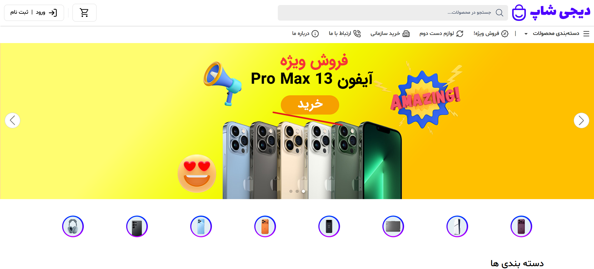 | 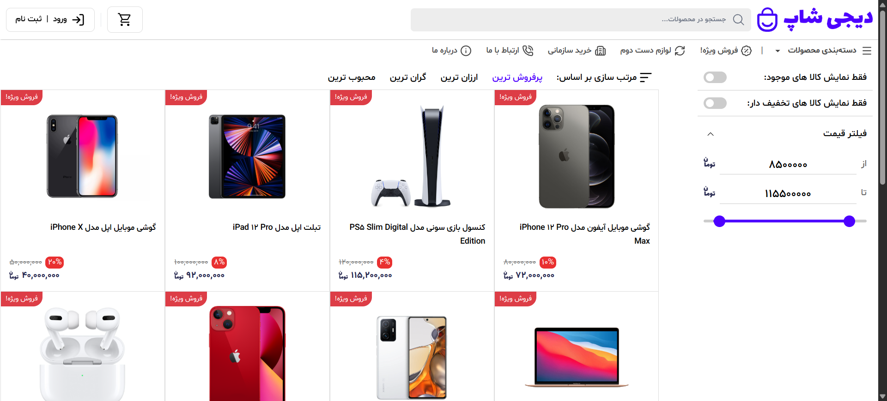 |

| Product Details | Cart |
| --- | --- |
| 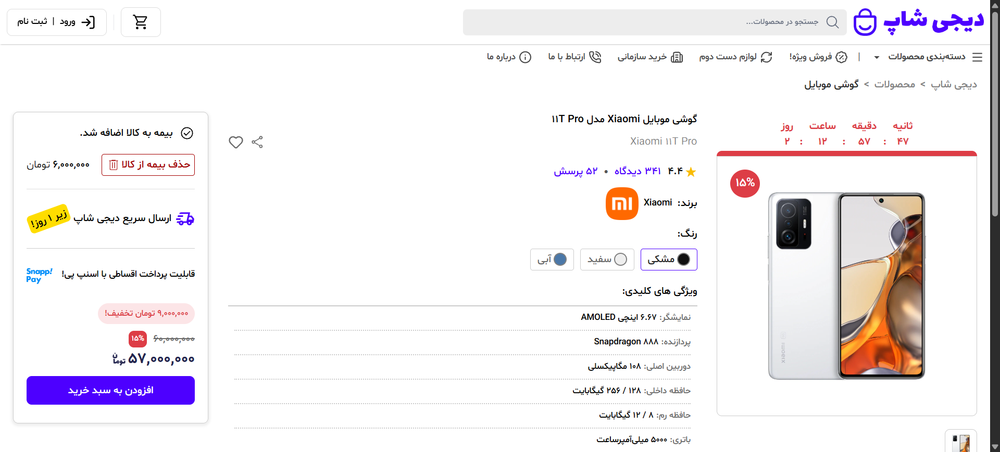 | 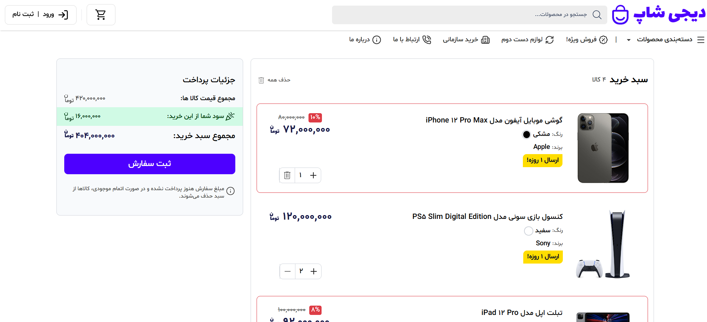 |

| Login | OTP Verification |
| --- | --- |
| 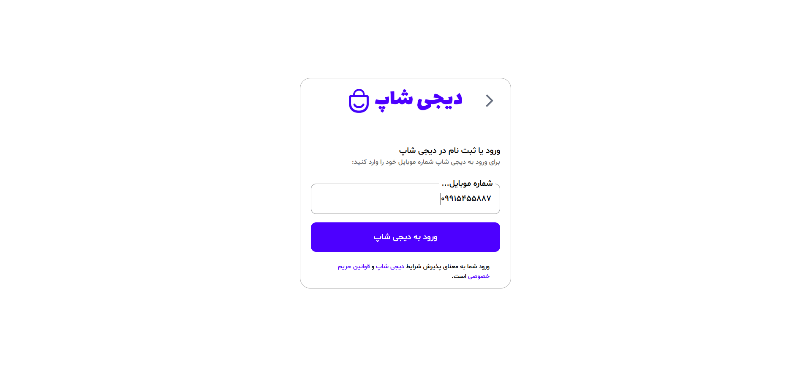 | 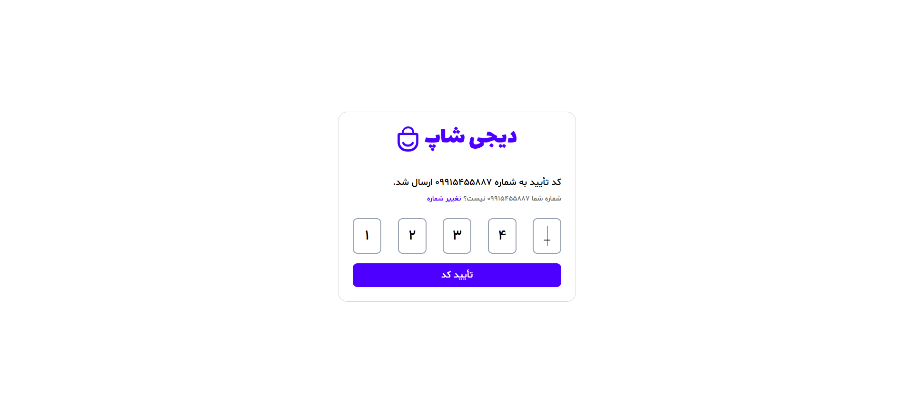 |

| Profile Dashboard | Orders List |
| --- | --- |
| 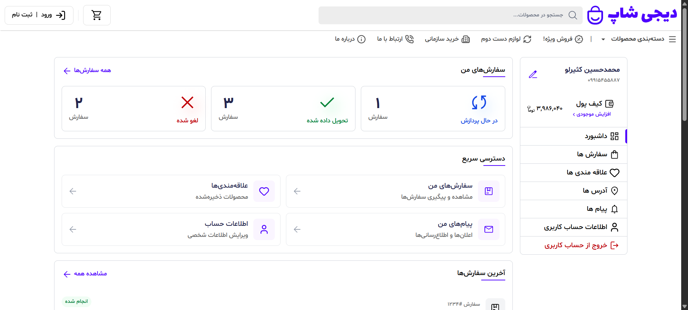 | 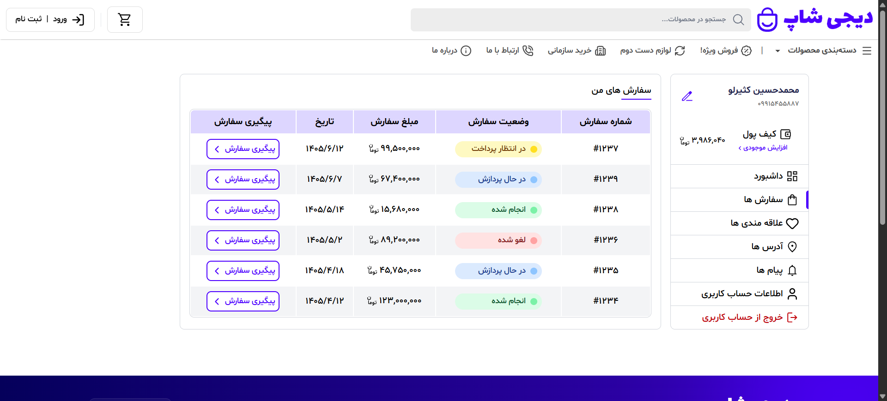 |

| Notifications | User Information |
| --- | --- |
| 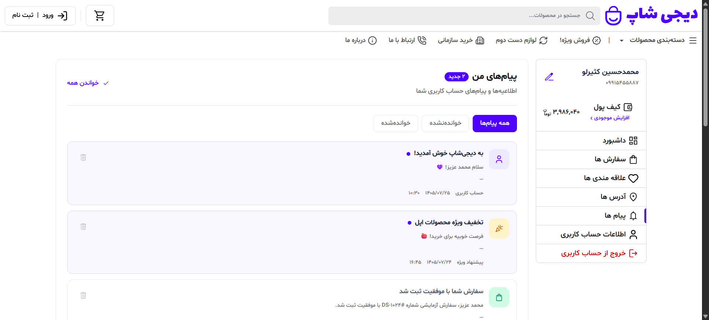 | 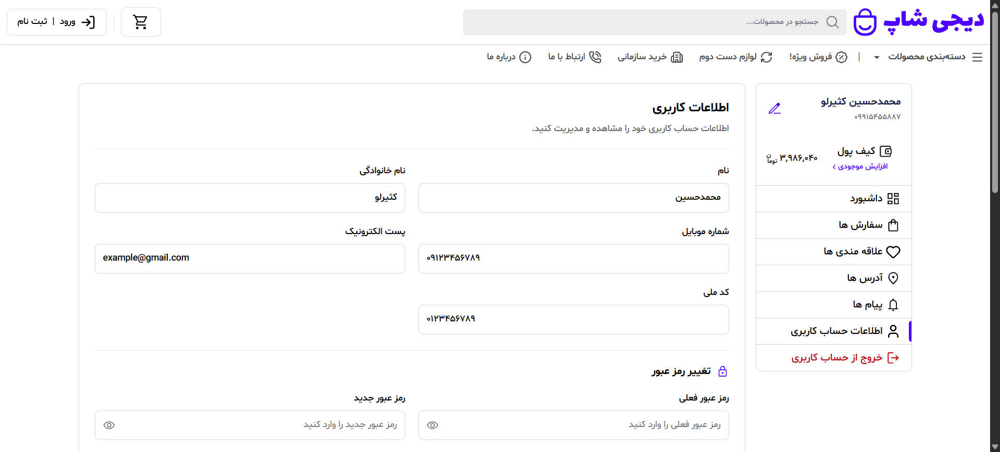 |

| Shipping | Payment |
| --- | --- |
| 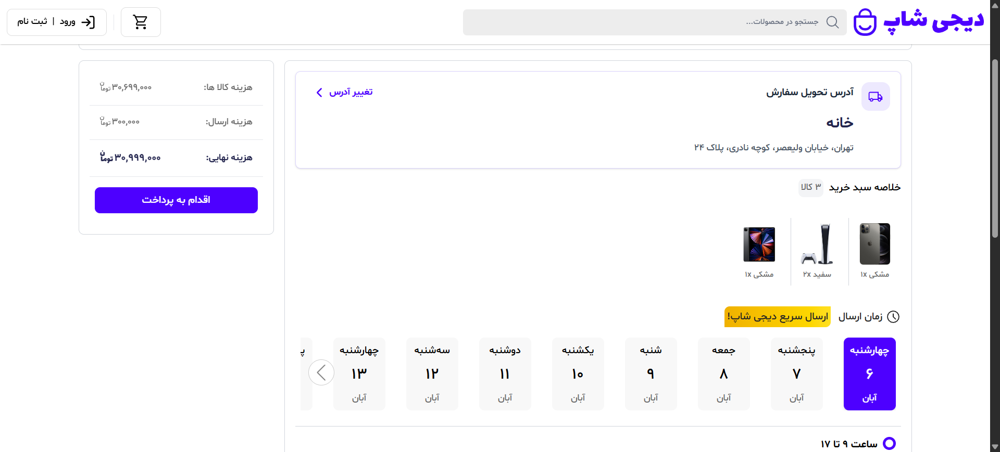 | 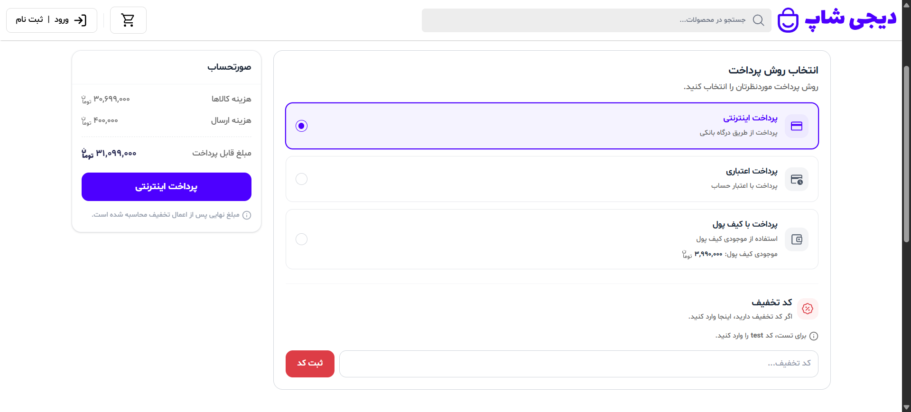 |

## ⚙️ Getting Started

### Prerequisites

Make sure you have [Node.js](https://nodejs.org/) and npm installed.

### Installation

1. Clone the repository:

   ```bash
   git clone https://github.com/MKasirloo/DigiShop-Next.git
   ```

2. Navigate to the project directory:

   ```bash
   cd DigiShop-Next
   ```

3. Install dependencies:

   ```bash
   npm install
   ```

4. Start the development server:

   ```bash
   npm run dev
   ```

5. Open [http://localhost:3000](http://localhost:3000) in your browser.

### Production Build

Build the application:

```bash
npm run build
```

Start the production server:

```bash
npm run start
```

## 📁 Project Structure

```text
DigiShop-Next/
├── app/
│   ├── api/
│   ├── products/
│   │   └── [id]/
│   ├── layout.js
│   └── page.js
├── components/
├── public/
│   ├── images/
│   └── screenshots/
├── data/
├── package.json
└── README.md
```

*The structure above is illustrative and may differ from the current project.*

## 🎯 Project Goals

- Build a practical e-commerce application using Next.js
- Improve component-based development skills
- Explore Next.js App Router and file-system-based routing
- Create responsive and accessible user interfaces
- Practice modern frontend architecture and state management
- Explore server-side rendering and modern web development workflows

## 👨‍💻 Author

**MKasirloo**

GitHub: [@MKasirloo](https://github.com/MKasirloo)

---

<p align="center">
  Made with ❤️ and Next.js
</p>